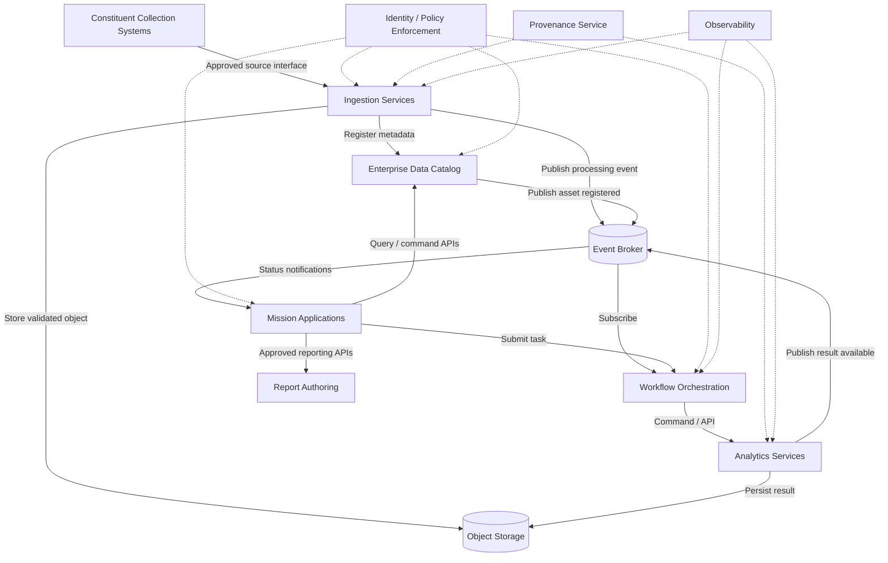

# 3. Architecture Methodology & Trade Study
Project: MESA — Mission Enterprise Services Architecture
Artifact: ALT-001 — Architecture Alternatives Analysis
Status: Draft for review (illustrative conceptual assessment)
Version: 1.0
Scope: Unclassified, hypothetical System-of-Systems (SoS) architecture
Portfolio note: MESA is an independently developed conceptual example. The evaluation scores, weights, scenarios, and decisions below are engineering assumptions for demonstration—not government-approved criteria, measured test results, or findings from a real program. No classified, proprietary, or program-specific information is represented.

## 3.1 Systems Engineering Methodology
MESA follows a mission-driven, requirements-based, model-centric process. Architecture alternatives are evaluated only after defining the operational problem and the externally observable needs of the constituent systems.
1. Define mission need and stakeholders: Identify the mission outcome, users, collection systems, external authorities, and constraints.
2. Develop the CONOPS and operational threads: Describe collection, ingestion, discovery, analysis, report approval, and dissemination, including degraded operations.
3. Derive and organize requirements: Decompose mission needs into the R-010–R-120 hierarchy and identify measurable acceptance criteria.
4. Identify architecture alternatives: Compare plausible integration and service-organization patterns against the same scenarios.
5. Perform trade analysis: Apply agreed criteria, documented assumptions, sensitivity checks, and risk considerations.
6. Select and document an architecture: Record the decision, rejected alternatives, consequences, and conditions that could trigger reassessment.
7. Develop logical and interface models: Allocate functions to SYS-* elements; define block, interface, behavior, data, and trust-boundary models.
8. Plan implementation and verification: Prioritize capabilities, define contracts, and trace requirements to tests and operational measures.

Primary traceability path: Mission Need → CONOPS → R-010…R-120 → ALT-001 → BDD-001 → IBD-001 → ACT-001 → IFC-001 → VER-001.

### Decision drivers
The proposed architecture must accommodate independently managed collection systems, inconsistent source formats, asynchronous processing, shared data discovery, secure access, and incremental modernization. Its design must not require every constituent system to be rebuilt or upgraded together.

## 3.2 Architecture Alternatives Identification
The alternatives below represent integration patterns and service-organization approaches, not mutually exclusive technology products. Some may be combined in a final architecture.

| ID |	Alternative | Description |	Strengths |	Limitations / tradeoffs |
| --- | --- | --- | --- | --- |
| A1 |	Point-to-point integration |	Direct source-to-consumer interfaces |	Simple for a few stable connections; potentially low hop count |	Interface growth, tight coupling, costly coordinated changes, fragmented governance |
| A2 |	Centralized hub-and-spoke / ESB |	A central mediator routes or transforms exchanges |	Central policy, protocol mediation, simplified legacy onboarding |	Shared bottlenecks, concentrated failure risk, change-control dependency |
| A3 |	Federated API-oriented services |	Constituents expose governed APIs while retaining ownership |	Preserves autonomy; direct authoritative queries; clear ownership |	Synchronous dependency chains, discovery complexity, inconsistent implementations without governance |
| A4 |	Event-driven / publish–subscribe |	Producers publish events to authorized subscribers through a messaging fabric	| Loose coupling, fan-out, asynchronous workloads, elastic consumers |	Eventual consistency, duplicate delivery, ordering limits, replay and schema governance challenges |
| A5 |	Hybrid event-driven + service-oriented/microservices |	Governed APIs for commands/queries; events for state changes and workflow triggers; modular enterprise capabilities |	Matches interaction pattern to use case; balances autonomy, interoperability, reuse, and scaling |	Greater operational and governance complexity; requires disciplined contract and observability practices |

### Evaluation scenarios
- S1 — New source onboarding: Add a collection source through a governed adapter without changing existing consumers.
- S2 — Automated mission thread: Notify the enterprise of new information, validate and register it, then initiate an analytical workflow.
- S3 — Authoritative query: An authorized analyst retrieves catalog metadata and task status with a bounded response time.
- S4 — Partial failure: A processing service or broker node fails without compromising data integrity or causing uncontrolled mission-wide disruption.
- S5 — Independent evolution: Upgrade a catalog or analytics service while maintaining compatible interfaces for other constituents.
- S6 — Security and provenance: Enforce policy at each protected interaction and preserve source-to-product lineage.

## 3.3 Evaluation Criteria & Weighting
The weights below are illustrative engineering judgments. They sum to 100% and must be validated with mission stakeholders before use in an actual acquisition or architecture baseline.

| Criterion |	Weight |	Assessment question |
| --- | --- | --- |
| C1 — Constituent autonomy |	20%	| Can constituents evolve and operate without synchronized redesign? |
| C2 — Interoperability |	20%	| Can heterogeneous systems exchange semantically governed information? |
| C3 — Resilience |	20%	| Can the enterprise isolate failures and recover safely? |
| C4 — Scalability |	15% |	Can producers and consumers scale for different workload patterns? |
| C5 — Security governance |	15%	| Can access policy, audit, and trust boundaries be enforced consistently? |
| C6 — Implementation simplicity |	10% |	How readily can the approach be built, operated, and sustained? |

Scoring scale: 1 = poor fit; 2 = limited fit; 3 = acceptable with mitigation; 4 = strong fit; 5 = very strong fit. A higher C6 score means simpler, not more complex.

Calculation: Weighted score = Σ (criterion weight × alternative rating), using weights as decimals. Maximum possible score = 5.00.

## 3.4 Architecture Trade Study (ALT-001)

Illustrative weighted decision matrix

| Alternative |	C1 (20%) |	C2 (20%) |	C3 (20%) |	C4 (15%) |	C5 (15%) |	C6 (10%) |	Weighted score / 5 |
| --- | --- |--- | --- | --- | --- | --- | --- |
| A1 — Point-to-point |	1 |	2 |	2 |	1 |	2 |	4 |	1.85 |
| A2 — Central hub / ESB |	2 | 3 |	2 |	3 |	3 |	3 |	2.60 |
| A3 — Federated APIs |	5 |	3 |	3 |	3 |	3 |	2 |	3.30 |
| A4 — Event-driven / Pub-Sub |	4 | 4 |	3 |	5 |	3 |	2 |	3.55 |
| A5 — Hybrid EDA + microservices |	4 |	5 |	4 |	5 |	4 |	2 |	4.15 |

Worked example (A5): (4×0.20) + (5×0.20) + (4×0.20) + (5×0.15) + (4×0.15) + (2×0.10) = 4.15.

Interpretation: Under the stated assumptions, A5 ranks highest. This is a screening result, not proof of superiority. The architecture still requires workload measurements, threat analysis, prototype testing, and stakeholder review. Ratings must be revisited if mission priorities change.

#### Tradeoff observations
- A1 is appropriate for isolated, low-change integrations but does not scale well as an enterprise default.
- A2 offers centralized mediation for legacy protocols, but an enterprise-wide single hub increases operational concentration risk. Targeted adapters or gateways may still be useful.
- A3 is valuable for authoritative data access and constituent autonomy, but an API-only approach is less suitable for long-running and fan-out processing.
- A4 improves decoupling for notifications and asynchronous workflows but does not replace transactional APIs, authoritative stores, or workflow ownership.
- A5 uses both governed APIs and event messaging, with microservices where independent deployment is justified. It demands stronger operational engineering than simpler alternatives.

#### Sensitivity and uncertainty
The result is sensitive to subjective ratings and stakeholder priorities. Before baselining, the team should:
1. Have mission, cybersecurity, operations, and sustainment stakeholders score alternatives independently.
2. Recalculate results under alternative weighting scenarios, including higher operational simplicity or security weights.
3. Compare estimated lifecycle cost, integration effort, and organizational readiness.
4. Prototype the most uncertain event, data consistency, and recovery behaviors.
5. Document dissenting assessments and conditions that would favor another alternative.

Decision gate: Proceed with A5 as the conceptual reference architecture, subject to verification of critical assumptions and approval of the final standards profile.

## 3.5 Selected Hybrid Architecture Decision

### Decision statement
MESA selects a hybrid Event-Driven / Publish–Subscribe and Service-Oriented / Microservices Architecture. Event-driven communication will support collection notifications, data availability, asynchronous processing, workflow triggers, and completion notifications. Modular enterprise services will implement ingestion, validation, catalog integration, workflow management, analytics, provenance, mission applications, and report authoring. Synchronous governed APIs will support explicit commands, authoritative queries, and transactions requiring immediate results.

The selected approach seeks to preserve constituent-system autonomy while establishing consistent enterprise interoperability, security, and information traceability. Microservices describe how capabilities are organized and deployed; publish–subscribe describes how relevant events are exchanged. A microservice may publish and consume events; the two patterns are complementary.
Initial service communication allocation
Service / component	Primary implementation or interface style	Event role	Representative interaction
SYS-030 Mission Applications	Governed APIs and modular application services	Consumer / publisher	Submit mission task; receive status-complete event
SYS-022 Ingestion & Interoperability	Containerized adapters and validation services	Consumer / publisher	Receive source notification; publish validated-data event
SYS-023 Workflow Orchestration	Stateful workflow service and APIs	Consumer / publisher	Start task on approved event; publish task outcome
SYS-011 Enterprise Data Catalog	Authoritative catalog APIs	Publisher / consumer	Register metadata transactionally; publish asset-registered event
SYS-012 Object Storage	Managed storage interface	Event source where supported	Store object; emit object-created notification
SYS-024 Analytics & AI	Independently deployable processing services	Consumer / publisher	Consume work item; publish result availability
SYS-025 Provenance & Evidence	Provenance APIs and durable records	Consumer	Capture processing evidence and lineage
SYS-021 ICAM / SYS-040 Zero Trust	Synchronous policy and identity enforcement	Limited lifecycle/audit events	Authorize protected request before access
SYS-080 Report Authoring	Governed authoring and approval APIs	Publisher	Publish report-approved event after authorization
SYS-050 Observability	Telemetry collection and analysis	Consumer	Correlate logs, metrics, and traces
SYS-110 Configuration Management	Controlled baseline APIs	Publisher	Announce approved configuration baseline
SYS-120 Digital Twin / Architecture Analytics	Model and analysis services	Consumer	Reconcile approved state changes with architecture model

Interaction rule: Publish facts about completed state changes as events. Use a command/API when a specific service must accept responsibility for an action. Use bulk/object transfer for large payloads; events can carry references and metadata rather than the entire dataset.
Logical interaction view

The diagram is a logical communication view, not a complete deployment design. Dashed lines denote cross-cutting relationships, not an assertion that security checks or provenance are optional. Protected interfaces require authorization even when an event notification has been received.

3.6 Decision Risks, Mitigations & Architecture Decision Record
Principal risks and controls
Risk ID	Risk / failure mode	Consequence	Mitigation / design control	Verification evidence
AR-01	Duplicate or replayed events	Repeated processing / inconsistent results	Event IDs, idempotent consumers, deduplication policy	Duplicate-delivery integration test
AR-02	Out-of-order delivery	Invalid workflow state	Partitioning/sequence policy where needed, state-machine guards	Reordering and concurrency test
AR-03	Broker or subscriber outage	Delayed mission processing	Durable queues, replicated broker deployment, backpressure, replay	Failover and backlog-drain test
AR-04	Partial storage/catalog transaction	Uncataloged or stale assets	Reconciliation workflow, transactional outbox where appropriate, compensating actions	Partial-failure recovery test
AR-05	API/event schema incompatibility	Broken consumers	Versioned contracts, compatibility rules, consumer contract tests	Contract regression test
AR-06	Distributed latency / cascading failures	Unavailable workflows	Timeouts, bounded retries, circuit breakers, bulkheads	Load and fault-injection test
AR-07	Unauthorized event or data access	Information disclosure / integrity loss	Authenticated workloads, topic ACLs, policy enforcement at data APIs, encryption	Security integration and access-denial tests
AR-08	Incomplete provenance / observability	Poor auditability and troubleshooting	Correlation IDs, trace propagation, durable provenance records, log protection	End-to-end lineage and trace inspection
AR-09	Microservice proliferation	Higher sustainment cost	Service-boundary review, ownership standards, deployment readiness criteria	Architecture governance review
AR-10	Constituent lifecycle divergence	Integration regressions	Compatibility windows, adapters, published deprecation policy	Mixed-version interoperability test

Architecture Decision Record — ADR-001
Field	Decision record
Title	Hybrid event-driven and service-oriented integration for MESA
Status	Proposed / conceptual portfolio decision
Context	Independent constituents require governed interoperability, asynchronous mission processing, authoritative access, and incremental evolution
Decision	Use publish–subscribe for asynchronous events and modular services with governed APIs for commands, queries, and authoritative transactions
Alternatives considered	Point-to-point, centralized hub/ESB, federated API-only, event-driven-only
Positive consequences	Loose coupling, extensibility, independently scalable workloads, reusable capabilities, improved workflow automation
Negative consequences	Distributed debugging, eventual consistency, messaging infrastructure dependencies, stronger governance and operations burden
Conditions	Approved contracts and security profiles; proven recovery behavior; measurable SLOs; integration and interoperability testing
Revisit when	Mission latency, cost, assurance, operational maturity, or constituent constraints materially change

Requirements and artifact traceability
Decision concern	Requirement families	Supporting portfolio artifacts
Mission integration and automated workflows	R-010, R-020	CONOPS, ACT-001, ACT-003
Constituent autonomy	R-030	BDD-001, IFC-001
Information exchange and contracts	R-040	IBD-001, IFC-001, DAT-001
Provenance and lineage	R-050	Provenance model, VER-001
Zero Trust and resilience	R-060	SEC-001, failure-mode tests
Deployment and observability	R-070	ACT-002, operational telemetry specification
Reporting and modernization	R-080, R-100	Report workflow, transition plan
Verification and configuration	R-090, R-110	VER-001, baseline register
Model synchronization and impact analysis	R-120	BDD-002, digital-thread mapping

Exit criteria before declaring the decision baselined
- [ ] Mission stakeholders approve evaluation criteria and weights.
- [ ] Operational and performance constraints are quantified (e.g., latency, throughput, availability, recovery).
- [ ] Architecture authority reviews service boundaries and trust boundaries.
- [ ] IFC-001 identifies API, event, and bulk-data contracts and owners.
- [ ] DAT-001 establishes minimum semantic and metadata profiles.
- [ ] Critical risks have defined test cases and owners in VER-001.
- [ ] A sensitivity analysis and at least one representative integration prototype have been completed.
- [ ] Architecture decision record is reviewed and configuration-controlled.
References and Standards Context
The following sources inform architectural principles and technical governance. They do not validate the illustrative numerical scores above.
1. Maier, M. W. (1998). Architecting principles for systems-of-systems. Systems Engineering, 1(4), 267–284. https://doi.org/10.1002/(SICI)1520-6858(1998)1:4%3C267::AID-SYS3%3E3.0.CO;2-D
2. ISO/IEC/IEEE 42010:2022. Software, systems and enterprise — Architecture description. https://www.iso.org/standard/74393.html
3. Rose, S., Borchert, O., Mitchell, S., & Connelly, S. (2020). Zero Trust Architecture, NIST SP 800-207. https://doi.org/10.6028/NIST.SP.800-207
4. Cloud Native Computing Foundation. CloudEvents Specification, stable release and protocol bindings. https://github.com/cloudevents/spec
Next portfolio artifacts: BDD-001 (logical decomposition), IBD-001 (interface flows), IFC-001 (interface contracts), DAT-001 (common information model), and VER-001 (verification evidence).
