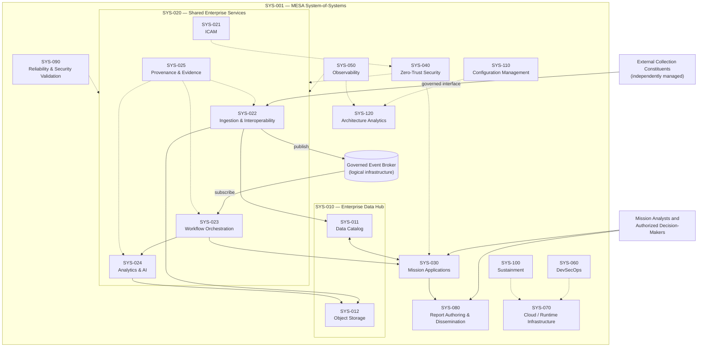
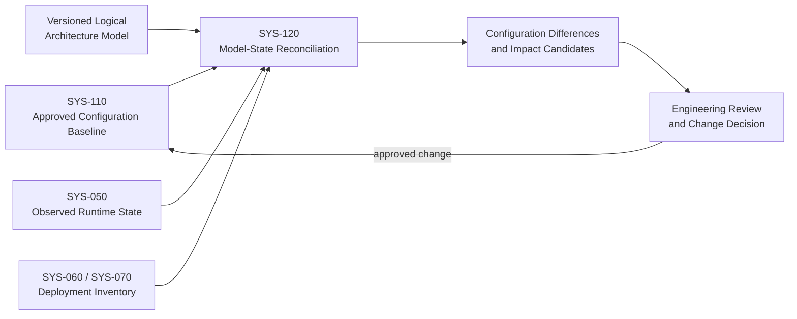

# 5. Logical System-of-Systems Architecture
Project: MESA — Mission Enterprise Services Architecture
Artifacts: BDD-001 — Enterprise Logical Decomposition; BDD-002 — Configuration and Architecture Analytics Concept
Version: 0.1 (conceptual draft)
Status: Draft for review — not a physical design or approved system baseline
Scope: Fictional, unclassified architecture; illustrative interfaces and components
### Modeling note: Mermaid diagrams below are logical architecture views for GitHub. They are not formal SysML BDDs or IBDs. Equivalent SysML models should be maintained separately if the portfolio claims formal model-based traceability.

## 5.1 System-of-Systems Decomposition

### System boundary
SYS-001 — Integrated Mission Information System-of-Systems coordinates mission information across independently managed collection systems, enterprise services, mission applications, and reporting capabilities. External collection constituents remain outside MESA's internal implementation boundary but connect through approved integration contracts.

### Logical decomposition hierarchy
| Element ID	| Logical subsystem / capability |	Primary responsibility |
| --- | --- | --- |
| SYS-001 |	Integrated Mission Information SoS |	Enterprise mission integration boundary |
| SYS-010 |	Enterprise Data Hub	| Governed data management and access |
| SYS-011 |	Enterprise Data Catalog	| Metadata registration, discovery and authoritative asset records |
| SYS-012 |	Object Storage	| Durable storage of mission objects and derived products |
| SYS-020 |	Shared Enterprise Services	| Common integration and enterprise functions |
| SYS-021 |	Identity, Credential and Access Management (ICAM)	| Identity, credentials and policy-supporting identity attributes |
| SYS-022 |	Ingestion & Interoperability	| Source adapters, validation and normalization |
| SYS-023 |	Workflow Orchestration	| Task coordination and execution-state management |
| SYS-024 |	Analytics & AI	| Governed analytical processing capabilities |
| SYS-025 |	Provenance & Evidence	| Processing history, lineage and evidence records |
| SYS-030 |	Mission Applications	| User-facing task initiation, discovery and results |
| SYS-040 |	Zero-Trust Security	| Policy enforcement and protected enterprise interactions |
| SYS-050 |	Observability	| Metrics, logs, traces, health and alerting |
| SYS-060 |	DevSecOps	| Secure build, delivery and deployment automation |
| SYS-070 |	Cloud / Runtime Infrastructure	| Hosting, network and runtime foundation |
| SYS-080 |	Enterprise Report Authoring & Dissemination	| Product composition, review, approval and release |
| SYS-090 |	Reliability & Security Validation	| Test, assurance and resilience validation capability |
| SYS-100 |	Sustainment	| Operations support and controlled maintenance |
| SYS-110 |	Configuration Management	| Approved baselines, change records and version control |
| SYS-120 |	Digital Twin / Architecture Analytics	| Model-state correlation, gap and impact analysis |

### Hierarchical ownership convention
SYS-010 is the parent logical capability for SYS-011 and SYS-012; SYS-020 groups shared enterprise functions including SYS-021–SYS-025. The other SYS-* elements represent enterprise-wide or user-facing capabilities. Grouping does not require all children to be deployed together or managed by the same organizational owner.

## 5.2 Enterprise Logical Architecture (BDD-001)

Interpretation: Solid arrows indicate representative operational dependencies or information exchanges; dashed arrows indicate cross-cutting governance, evidence, or support relationships. The diagram deliberately omits many-to-many exchanges to remain readable. The event broker is logical integration infrastructure, not an additional independently managed mission system. IBD-001 will specify actual ports, contracts, directions, and trust boundaries.

## Logical interaction sequence
1. A constituent system exposes authorized information or publishes an availability notification.
2. Ingestion adapters authenticate, validate and normalize data under approved contracts.
3. Approved objects are stored and their metadata is registered in the catalog.
4. A catalog-registered event is published after successful registration; reconciliation handles partial failures.
5. Workflow orchestration consumes an authorized trigger and coordinates analytical services.
6. Results are stored, registered and linked to processing provenance.
7. Mission applications expose authorized results; report services manage review and dissemination.
8. Zero-Trust enforcement, observability, configuration management and assurance span the interactions.

## 5.3 Subsystem Responsibilities & Ownership
| Capability |	Logical owner (role, illustrative) |	Authoritative state / interface |	Key dependency |
| --- | --- | --- | --- |
| Mission Applications (SYS-030) |	Mission application product owner |	User tasks and application state |	ICAM, workflow, catalog |
| Ingestion (SYS-022) |	Data integration team |	Adapter receipts and processing state	| Constituent contracts, broker, schemas |
| Workflow (SYS-023)	| Workflow platform owner	| Workflow execution state	| Broker, processors, state store |
| Catalog (SYS-011)	| Data governance team	| Asset metadata and discoverability	| Object storage, metadata rules |
| Object Storage (SYS-012)	| Data platform owner	| Persisted object | versions	Access policy, durability controls |
| Analytics (SYS-024)	| Analytics capability owner	| Analytical processing results	| Workflow, catalog, compute |
| Provenance (SYS-025)	| Data governance / audit owner	| Lineage and evidence records	| Processing events and object IDs |
| ICAM / Zero Trust (SYS-021, SYS-040)	| Security authority	| Identity attributes, policy decisions	| Trusted identity and policy stores |
| Reporting (SYS-080)	| Reporting capability owner	| Report state and release records	| Mission applications, catalog, policy |
| Observability (SYS-050)	| Operations owner	| Telemetry and alert records	| Instrumented services |
| DevSecOps / Runtime (SYS-060, SYS-070)	| Platform engineering	| Deployment state and infrastructure	| Configuration baselines |
| Configuration / Analytics (SYS-110, SYS-120)	| Architecture and CM authority	| Approved baseline and model correlation	| CM records, telemetry |

Design principle: An authoritative service owns its state. Other services access that state through governed APIs or consume approved change events; they do not write directly into another service's internal database.

## 5.4 Service Allocation — Microservices vs. Publish–Subscribe
Microservices describe capability boundaries and deployability. Publish–subscribe describes asynchronous communication. They can coexist within the same capability.

| Logical capability |	Microservices / governed API role |	Event role	| Preferred interaction |
| --- | --- | --- | --- |
| SYS-030 Mission Applications | User-facing task and discovery APIs |	Consume task-status events | API commands + asynchronous notifications |
| SYS-022 Ingestion |	Adapters, validators, normalizers	| Consume source notifications; publish validated-data events	| Event-driven pipelines + source APIs |
| SYS-023 Workflow | Execution state, task APIs | Consume triggers; publish task outcomes | Stateful orchestration + events |
| SYS-011 Catalog |	Authoritative metadata and discovery APIs |	Publish asset-registered events	| Transactional API + post-commit event |
| SYS-012 Object Storage	| Managed storage API, not necessarily custom microservice	| Optional object-change notifications	| Object API + event notification |
| SYS-024 Analytics | Independently deployable processors | Consume work events; publish results |	Async jobs; API where response is bounded |
| SYS-025 Provenance | Lineage query and evidence APIs | Consume processing evidence events | Durable evidence capture + API query |
| SYS-021 / SYS-040 Security |	Identity and policy enforcement services | Limited lifecycle/audit notifications |	Synchronous enforcement on protected access |
| SYS-080 Reporting | Authoring, approval, dissemination APIs |	Publish approval/release events | APIs for state transitions + events |
| SYS-050 Observability | Telemetry aggregation and alerting services |	Consume telemetry streams |	Streaming ingestion; query APIs |
| SYS-060 DevSecOps | Deployment and pipeline services | Pipeline / release triggers | Controlled CI/CD workflows |
| SYS-110 Configuration | Baseline and change-control APIs | Publish approved baseline changes | Authoritative API + change events |
| SYS-120 Architecture Analytics |	Model management and reconciliation services | Consume approved state changes |	Model queries + async updates |

### Communication selection rules
- Use synchronous APIs for explicit commands, authorization decisions, bounded queries and authoritative state transitions requiring an immediate response.
- Use events to announce completed state changes and trigger independent consumers; do not confuse a fact event with an addressed command.
- Use object transfer for large data payloads; events generally carry identifiers, metadata and authorized retrieval references rather than unrestricted full payloads.
- Design for duplicates and reordering: event consumers need idempotency, correlation IDs, durable delivery profiles and replay policies.
- Avoid distributed database coupling: publish change events after authoritative commits using an outbox or reconciliation pattern where required.
- Maintain policy enforcement at every protected boundary: an authenticated event subscriber is not automatically authorized to retrieve the underlying object.

## 5.5 Digital Twin & Configuration Management Concept (BDD-002)
SYS-120 is a proposed architecture-state analytics capability. It may become a digital twin only if a defined purpose, model fidelity, operational synchronization, and validation evidence are established. The initial design should not claim real-time fidelity or predictive accuracy.

### BDD-002 responsibilities

| Function | Input | Output | Governance requirement |
| --- | --- | --- | --- |
| Baseline ingest |	Approved architecture / configuration record |	Versioned reference state |	Approved CM authority |
| Observed-state ingest | Telemetry and deployment inventory |	Time-stamped observed state | Data provenance and freshness |
| Reconciliation |	Reference state + observed state | Difference / discrepancy list |	Defined comparison rules |
| Impact analysis |	Proposed interface or component change | Candidate dependency impacts |	Engineering review |
| Change disposition | Reviewed discrepancy or impact |	Approved action / exception | Audit trail and baseline control |

Limitations: Missing telemetry, delayed events, and incomplete configuration inventory can produce false differences. Reconciliation results are advisory until reviewed against an approved authoritative baseline.

## 5.6 Logical Architecture Rationale

Why this decomposition?
1. Constituent autonomy: Adapters and contracts isolate independently managed collection systems from enterprise internal changes (R-030).
2. Loose coupling: Event-driven integration reduces the need for producers to know every downstream consumer (R-020, R-040).
3. Authoritative data management: Object storage persists data while catalog services govern discoverability and metadata (R-040, R-050).
4. Reusable mission capabilities: Workflow, analytics, provenance and reporting have separable responsibilities and lifecycle controls (R-010, R-080, R-100).
5. Security by design: Identity and policy enforcement remain cross-cutting and synchronous where access decisions are required (R-060).
6. Operational assurance: Observability, DevSecOps, configuration control and verification are designed into the enterprise rather than added after deployment (R-070, R-090, R-110).
7. Model-centric evolution: Architecture analytics can compare approved baselines with observed state to support controlled modernization (R-120).

### Principal logical risks and planned controls
| Risk | Impact | Proposed control | Planned evidence |
| --- | --- | --- | --- |
| Event broker unavailable |	Delayed ingestion/workflow triggers |	Replication, durable queues, backpressure, replay |	Failover and backlog test |
| Duplicate or out-of-order events | Incorrect processing state | Idempotency, state-machine guards, sequence policy |	Replay/reordering test |
| Catalog registration failure	| Stored but undiscoverable object | Transactional boundary + reconciliation	Partial-failure test |
| Service proliferation	| Higher operational complexity |	Service-boundary review and ownership registry | Architecture review |
| Cross-service authorization gap | Unauthorized data access | ICAM, policy enforcement points, object API checks |	Denial and privilege tests |
| Model/runtime divergence | Incorrect architecture analysis |	Source-of-truth rules, freshness metrics, review |	Reconciliation test |

## Architectural views still required

| Artifact | Purpose |	Status |
| --- | --- | ---- |
|BDD-001 | Enterprise logical decomposition | Conceptual Mermaid view drafted; formal SysML model pending |
| BDD-002	| Configuration / architecture analytics decomposition | Conceptual Mermaid view drafted; formal SysML model pending |
| IBD-001	| Ports, exchanges and trust boundaries	| Pending |
| IBD-002	| Shared services interfaces | Pending |
| IBD-003 | ICAM and Zero-Trust interfaces | Pending |
| IBD-004 | Dataflow and workflow interfaces | Pending |
| IFC-001 | Interface contract register	| Pending |
| DAT-001 | Common information model | Pending |
| TRC-001 | Complete requirements-to-design traceability | Pending |
| VER-001 | Requirements verification plan and matrix |Pending |

## Architecture exit criteria
- [ ] Reconcile all SYS-* identifiers across diagrams and documents.
- [ ] Review system boundary and constituent ownership with representative stakeholders.
- [ ] Map each Level 2 requirement to logical blocks and interfaces.
- [ ] Define API/event/object-transfer contracts and trust boundaries in IBD-001 / IFC-001.
- [ ] Record decision risks, verification criteria, and assumptions in the trade study and VER-001.
- [ ] Distinguish logical services from actual deployment units and managed infrastructure.

Related portfolio documents: [CONOPS](02-Concept-of-Operations.md) · [Trade Study](03-Architecture-Trade-Study.md) · [Requirements Engineering](04-Requirements-Engineering.md)
